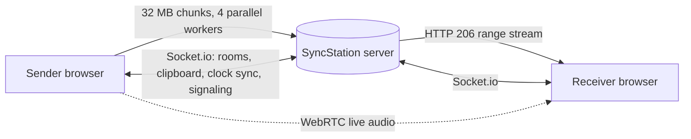

# SyncStation

Your devices, in sync. No accounts, no cloud, just your network.

Share clipboard text, stream huge files, and cast live audio between your own devices, all from a server you host yourself.

> **Status: `v0.2.0-mvp`.** The browser version works on Windows and Linux. A desktop wrapper, Android shortcut and PWA install are planned (see [Roadmap](#roadmap)).

---

## How it fits together



---

## Features

### Large file sharing (designed for up to 50 GB)
- Files are split into **32 MB chunks** in the browser and uploaded by **4 parallel workers**, plus **1 dedicated worker** that re-sends missing chunks (checked every 10 chunks).
- A custom **chunk tracker** on the server keeps the contiguous order of incoming chunks and identifies which ones are missing.
- **Stream while uploading:** a receiver can start downloading before the sender has finished. The server does not wait for the whole file.
- **HTTP range support:** `206 Partial Content` and `200 OK` are handled, so downloads can resume. `HEAD` requests are handled so mobile download managers don't abort.
- Ordered byte delivery across chunks using `pipe(res, { end: false })`, with the stream closed cleanly after the final chunk.
- Files are streamed from disk and never held fully in memory.
- A storage cleanup script keeps the shared folder tidy.

### Live audio cast
- Browser tab/system audio is shared over **WebRTC**, with Socket.io used for signaling.
- Controller-based, role-based playback (broadcaster and listeners).
- Screen Wake Lock keeps phones awake during an active stream.

### Clock synchronisation
- The server is the source of truth for time.
- Each client estimates its offset with **Cristian's algorithm**: a timestamp exchange over Socket.io, round-trip time measured, and `offset = server time - (send time + RTT/2)`.
- Small playback-speed adjustments smooth out drift instead of causing audible jumps.

### Clipboard sync and rooms
- Bi-directional text sharing between devices in the same room, over WebSockets (Socket.io).
- Unique room codes, invite links and QR codes for quick onboarding.

---

## Security model

**What it does**
- Runs over **HTTPS/WSS** (`key.pem` / `cert.pem`), so traffic on the network is encrypted in transit.
- No accounts and no third-party API keys. Data stays on the host machine by default.
- WebRTC audio is encrypted by design (DTLS-SRTP).

**What it does not do (yet)**
- A **room code is not authentication.** Anyone with the code can join the room. Private room passwords are on the roadmap.
- With a self-signed certificate, browsers show a warning the first time. Installing a local CA with [mkcert](https://github.com/FiloSottile/mkcert) avoids it.
- If you enable **Tunnelmole** for public access, traffic goes through a third-party tunnel. Don't use it for sensitive files.
- WebRTC across different networks may need a STUN/TURN server, which is a third-party service. On the same LAN it connects directly.

---

## Tech stack

| Layer | Tools |
|---|---|
| Backend | Node.js, Express, Socket.io, multer |
| Frontend | React, TypeScript, Vite, Context API |
| Real-time | Socket.io (signaling, clipboard, clock sync), WebRTC (audio) |
| Transfers | Chunked HTTP uploads, HTTP range requests (206) |
| Hosting | Self-hosted, HTTPS, optional Tunnelmole tunnel |

---

## Getting started

1. **Clone** the repository.
2. **Create the HTTPS certificate** (two commands, see [HTTPS certificate](#https-certificate)).
3. **Install dependencies** (once):
   ```bash
   npm install && npm install --prefix client && npm install --prefix server
   ```
4. **Run it.** From the project root, one command starts the client and server together:
   ```bash
   npm run dev
   ```
   For everyday use, build the client and run the server:
   ```bash
   npm run build-and-run
   ```
5. **Open the app** in a browser, create a room, then join from another device with the QR code or link.

> Phone browsers only allow clipboard and capture features on HTTPS (or localhost), which is why the server runs over HTTPS. For large files, wired Ethernet or 5 GHz Wi-Fi is recommended, since speed depends on your local network.

---

## HTTPS certificate

SyncStation needs `key.pem` and `cert.pem` in the `server/` folder. Create them once on the machine that hosts the server.

**1. Find the host machine's LAN IP**

```bash
# Windows
ipconfig

# Linux
hostname -I
```

Look for an address like `192.168.1.5`.

**2. Create the certificate** (replace `192.168.1.5` with your IP)

Option A: [mkcert](https://github.com/FiloSottile/mkcert) (recommended, no browser warning on the host machine)

```bash
mkcert -install
mkcert -key-file server/key.pem -cert-file server/cert.pem 192.168.1.5 localhost 127.0.0.1
```

Option B: OpenSSL (browsers will show a warning you can click through)

```bash
openssl req -x509 -newkey rsa:2048 -nodes -keyout server/key.pem -out server/cert.pem -days 365 \
  -subj "/CN=localhost" -addext "subjectAltName=IP:192.168.1.5,DNS:localhost,IP:127.0.0.1"
```

**3. Open the app from another device**

Use `https://192.168.1.5:3000`. Phones will warn about the certificate the first time; tap through it once.

> The certificate is tied to the IP you typed. If your router gives the host machine a new IP, create the certificate again, or reserve a fixed IP for it in your router settings. Never commit `key.pem` to git (`*.pem` is already ignored).

---

## Known limitations

- File transfer has been tested one sender to one receiver. Several receivers on the same file, and the full 50 GB size, have not been tested thoroughly yet.
- Automatic reconnect after a dropped connection is not implemented yet.
- Tab/system audio capture works on desktop Chrome; mobile browsers may be limited.
- Tested on Windows and Linux only.

---

## Roadmap

- [ ] Automatic reconnect system
- [ ] Electron wrapper for Windows and Linux
- [ ] Android shortcut and installable PWA
- [ ] App logo
- [ ] Private room passwords
- [ ] Network jitter monitoring
- [ ] One-click host script

---

## Project structure

```
client/    React + TypeScript frontend
server/    Express + Socket.io backend, chunk tracker, streaming engine
shared/    Shared types and constants
```

---

Built by Rahul Suthar as a learning project in networking, streaming and real-time systems.